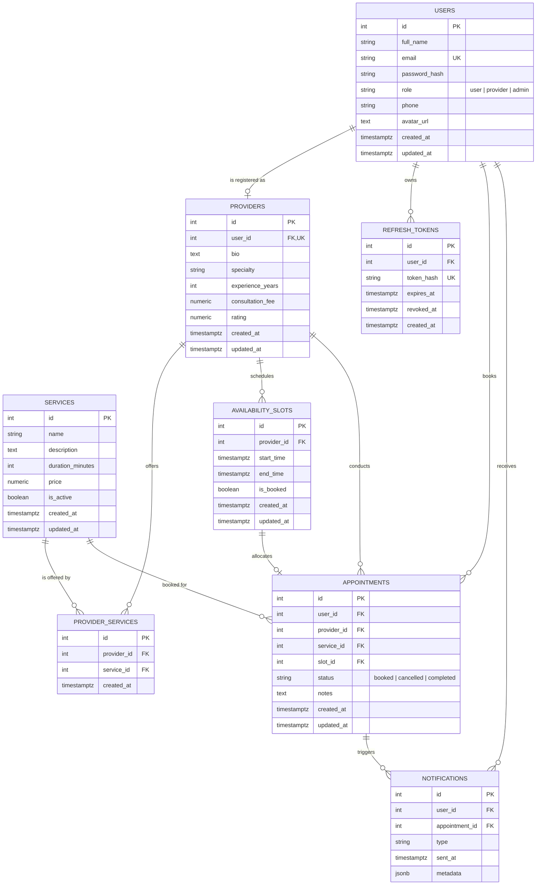

# Synapse Database Entity-Relationship Diagram

This document illustrates the complete relational database design for **Synapse**, an enterprise-grade appointment management platform. The schema is implemented directly in PostgreSQL 16 using native constraints, foreign keys, cascading rules, and partial indexes without any ORM abstraction layer.

## Mermaid Crow's Foot ER Diagram



## Key Relational Integrity Constraints
1. **User Identity & Roles**: `users.email` is strictly `UNIQUE`. Role is constrained by `CHECK (role IN ('user', 'provider', 'admin'))`.
2. **Provider One-to-One Profile**: `providers.user_id` has a `UNIQUE` constraint referencing `users.id`, preventing duplicate provider profiles per user.
3. **Many-to-Many Provider-Services**: Junction table `provider_services` enforces `UNIQUE(provider_id, service_id)` with `ON DELETE CASCADE`.
4. **Slot Chronological Validity**: `availability_slots` enforces `CHECK (end_time > start_time)`.
5. **Concurrency & Double-Booking Prevention**:
   - `appointments` maintains a **Partial Unique Index** on `slot_id` for active reservations:
     ```sql
     CREATE UNIQUE INDEX uq_active_slot_booking ON appointments(slot_id) WHERE status = 'booked';
     ```
   - This ensures at the database engine level that no two active appointments can point to the same availability slot, even under concurrent write conditions.
6. **Notification Deduplication**: `notifications` enforces `UNIQUE (appointment_id, type)` so automated cron workers never send duplicate reminders for the same window.
